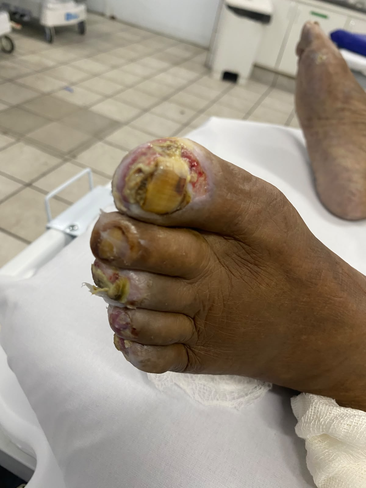

# Quando uma lesão digital exige mais do que um curativo?

Durante o internato médico, a observação de lesões ulceradas e áreas de possível necrose nos dedos levanta uma questão importante: **qual mecanismo está comprometendo a integridade e a viabilidade dos tecidos?**

A aparência da ferida é apenas o ponto de partida. Para compreender o caso, é necessário integrar a avaliação morfológica da lesão, a perfusão vascular, a possibilidade de infecção, a presença de neuropatia e os fatores sistêmicos que interferem na cicatrização.

Este caso é apresentado com finalidade educacional, a partir de uma imagem clínica. Como não dispomos, nesta publicação, da história completa, dos exames complementares e do diagnóstico final, as hipóteses discutidas não devem ser interpretadas como diagnósticos confirmados do paciente.

## 1. Apresentação clínica

A fotografia documenta lesões ulceradas em múltiplos dedos, com áreas de coloração amarelada, regiões avermelhadas e alterações de coloração que podem corresponder a diferentes componentes do leito da ferida.

A imagem, isoladamente, não permite determinar com segurança a profundidade das lesões, a viabilidade dos tecidos, a presença de infecção ou a causa subjacente.

**Questão clínica:** estamos diante de uma lesão predominantemente isquêmica, infecciosa, traumática ou decorrente da combinação de diferentes mecanismos?

Essa distinção é fundamental, pois a escolha do tratamento depende da etiologia e da gravidade, e não apenas da aparência superficial da ferida.

{fig-align="center" width="85%"}

*Figura 1. Aspecto clínico das lesões digitais.*

## 2. Diagnóstico diferencial

### 2.1. Isquemia digital e doença arterial periférica

A redução do fluxo sanguíneo pode comprometer a oferta de oxigênio e nutrientes, prejudicar a reparação tecidual e culminar em ulceração e necrose. A doença arterial periférica é especialmente importante em pessoas com diabetes, mas a possibilidade de isquemia não deve ser atribuída automaticamente à presença de uma ferida.

A avaliação deve incluir história de dor em repouso, evolução da lesão, alterações de temperatura e coloração, palpação de pulsos e testes vasculares objetivos. Quando disponíveis e indicados, podem ser utilizados índice tornozelo-braquial, pressão digital, índice dedo-braquial e métodos de avaliação Doppler.

Em casos de suspeita de isquemia ameaçadora do membro, a avaliação vascular não deve ser postergada.

### 2.2. Infecção de partes moles e osteomielite

Feridas podem ser complicadas por infecção superficial ou profunda. A investigação considera purulência, eritema, calor, edema, dor, extensão do comprometimento e sinais sistêmicos. A ausência de dor não exclui infecção em pacientes com neuropatia.

Quando houver suspeita de acometimento ósseo, devem ser considerados o exame da ferida, a avaliação clínica e, conforme o contexto, radiografia simples e ressonância magnética. A escolha dos exames depende da probabilidade clínica e dos achados iniciais.

A colonização de uma ferida não equivale necessariamente a infecção. Antibióticos não devem ser utilizados apenas para promover a cicatrização de úlceras clinicamente não infectadas.

### 2.3. Neuropatia e traumatismo repetitivo

A neuropatia periférica pode reduzir a sensibilidade protetora, permitindo que pressões, atritos ou pequenos traumatismos se repitam sem percepção adequada. Deformidades digitais e calçados inadequados podem aumentar a pressão sobre áreas específicas.

Por isso, a investigação deve incluir sensibilidade protetora, deformidades, calosidades, distribuição das lesões e história de trauma.

### 2.4. Outras causas

Dependendo da história e do exame físico, também podem ser consideradas vasculites, fenômenos trombóticos, fenômenos embólicos, doenças autoimunes, lesões térmicas ou químicas e outras causas de comprometimento vascular ou tecidual.

O diagnóstico deve ser orientado pelos achados clínicos e pelos exames pertinentes, evitando atribuir a lesão a uma causa única sem evidências suficientes.

## 3. Fisiopatologia: como o tecido perde viabilidade?

A integridade tecidual depende da perfusão adequada, da disponibilidade de oxigênio, da resposta imunológica, da integridade neurológica e da capacidade de reparação.

Na isquemia, a redução da oferta de oxigênio compromete o metabolismo celular. Quando intensa ou prolongada, pode causar lesão irreversível e morte celular. A extensão do dano depende, entre outros fatores, da intensidade e da duração da redução do fluxo sanguíneo.

Na neuropatia, a perda da sensibilidade protetora favorece microtraumas repetitivos. A pressão mecânica persistente pode contribuir para a ruptura da pele e impedir a cicatrização.

Quando há infecção, a resposta inflamatória e a destruição tecidual podem agravar a lesão. Isquemia e infecção podem coexistir, aumentando a complexidade do tratamento.

**Implicação clínica:** tratar somente a superfície da ferida, sem abordar isquemia, infecção ou pressão mecânica, pode ser insuficiente para alcançar a cicatrização.

## 4. Avaliação clínica sistemática

A abordagem deve documentar os seguintes elementos:

- **História clínica:** diabetes, duração da doença, controle glicêmico, doença arterial periférica, neuropatia, tabagismo, doença renal, trauma e evolução das lesões.
- **Exame da ferida:** localização, comprimento, largura, profundidade, leito, bordas, exsudato e estruturas expostas.
- **Avaliação vascular:** temperatura, coloração, pulsos, enchimento capilar e testes objetivos de perfusão conforme a indicação.
- **Avaliação neurológica:** sensibilidade protetora e presença de deformidades.
- **Investigação de infecção:** sinais locais e sistêmicos, extensão do comprometimento e suspeita de envolvimento profundo.
- **Exames complementares:** selecionados conforme as hipóteses diagnósticas, a gravidade e os achados do exame físico.

A avaliação deve ser repetida ao longo do acompanhamento, permitindo identificar progressão, resposta ao tratamento e necessidade de mudança de conduta.

## 5. Cuidados locais das úlceras

As recomendações da International Working Group on the Diabetic Foot (IWGDF) destacam que o cuidado local deve integrar uma abordagem multidisciplinar. Mesmo uma cobertura apropriada não compensa isquemia não tratada, infecção inadequadamente controlada ou trauma persistente.

### 5.1. Limpeza e proteção

A limpeza deve remover resíduos e permitir a avaliação adequada do leito da ferida. Os pés devem ser lavados, mas não deixados de molho, pois a maceração pode comprometer a pele.

A cobertura deve ser escolhida conforme a profundidade, a quantidade de exsudato e as condições do tecido. Em geral, busca-se controlar o excesso de umidade e manter um ambiente favorável à cicatrização, evitando maceração da pele adjacente.

### 5.2. Desbridamento

O desbridamento pode remover tecido desvitalizado e calosidade quando indicado, favorecendo a avaliação da ferida e o manejo local. A técnica e a frequência devem ser definidas por profissional capacitado, conforme a condição clínica.

**Atenção à isquemia:** na presença de necrose seca e suspeita de perfusão gravemente comprometida, é necessário avaliar a condição vascular antes de decidir pela remoção do tecido. Nem toda área escurecida deve ser desbridada de maneira indiscriminada.

### 5.3. Alívio de pressão (*offloading*)

Reduzir a pressão e o trauma repetitivo é parte essencial do tratamento das úlceras relacionadas ao diabetes. O método deve considerar a localização da ferida, a biomecânica, a capacidade de marcha e a presença de infecção ou isquemia.

Em lesões não plantares, como algumas úlceras digitais, podem ser necessários dispositivos removíveis, adaptações de calçados, órteses ou outras estratégias específicas. A escolha deve ser individualizada.

### 5.4. Antimicrobianos e coberturas especiais

Antibióticos sistêmicos são indicados quando há infecção clínica, de acordo com a gravidade, os agentes prováveis, os resultados microbiológicos quando indicados e os protocolos locais.

Antibióticos tópicos ou coberturas antimicrobianas não devem ser empregados indiscriminadamente com o único objetivo de acelerar a cicatrização de uma úlcera não infectada.

Intervenções avançadas podem ser consideradas em casos selecionados que não evoluem com o cuidado padrão adequadamente realizado. Elas não substituem o tratamento da infecção, a correção da isquemia nem o alívio de pressão.

## 6. Sinais de gravidade e encaminhamento

Necrose progressiva, gangrena, suspeita de isquemia importante, infecção profunda, abscesso, exposição óssea ou sinais sistêmicos exigem avaliação médica urgente.

A associação entre infecção e isquemia demanda atenção especial, pois pode aumentar o risco de perda tecidual e amputação. A abordagem pode exigir participação de equipes de cirurgia vascular, cirurgia, infectologia, endocrinologia e profissionais especializados no cuidado de feridas, conforme os achados.

## 7. Aprendizados do caso

Este caso reforça três princípios do raciocínio clínico:

1. **A aparência não define a etiologia.** Lesões semelhantes podem resultar de mecanismos diferentes, que precisam ser investigados.
2. **O cuidado local faz parte de uma estratégia maior.** Limpeza, cobertura e desbridamento, quando indicados, devem estar associados à avaliação da perfusão, ao controle de infecção e ao alívio de pressão.
3. **A gravidade precisa ser reconhecida precocemente.** Suspeita de isquemia ou infecção profunda muda a prioridade e a urgência da abordagem.

A principal pergunta diante de uma úlcera digital não é apenas qual curativo utilizar, mas **qual processo está impedindo a cicatrização e ameaçando a viabilidade do tecido?**

---

## Referências

1. Schaper NC, van Netten JJ, Apelqvist J, et al. Practical guidelines on the prevention and management of diabetes-related foot disease (IWGDF 2023 update). *Diabetes/Metabolism Research and Reviews*. 2024. [Texto completo](https://onlinelibrary.wiley.com/doi/full/10.1002/dmrr.3657).

2. Chen P, Campillo Vilorio N, Dhatariya K, et al. Guidelines on interventions to enhance healing of foot ulcers in people with diabetes (IWGDF 2023 update). *Diabetes/Metabolism Research and Reviews*. 2024;40(3):e3644. [DOI: 10.1002/dmrr.3644](https://doi.org/10.1002/dmrr.3644).

3. Senneville É, Albalawi Z, van Asten SA, et al. IWGDF/IDSA Guidelines on the Diagnosis and Treatment of Diabetes-related Foot Infections. *Clinical Infectious Diseases*. 2023. [Texto completo](https://academic.oup.com/cid/advance-article/doi/10.1093/cid/ciad527/7287196).

4. International Working Group on the Diabetic Foot. IWGDF Guidelines, 2023 update. [Diretrizes e documentos oficiais](https://iwgdfguidelines.org/guidelines-2023/).

5. Sociedade Brasileira de Angiologia e de Cirurgia Vascular. Diretrizes da Sociedade Brasileira de Angiologia e de Cirurgia Vascular sobre o pé diabético. 2023. [DOI: 10.1590/1677-5449.202300872](https://doi.org/10.1590/1677-5449.202300872).

*Conteúdo educacional destinado à discussão de conceitos clínicos. Não substitui avaliação individual, protocolos institucionais ou decisão da equipe assistencial.*

